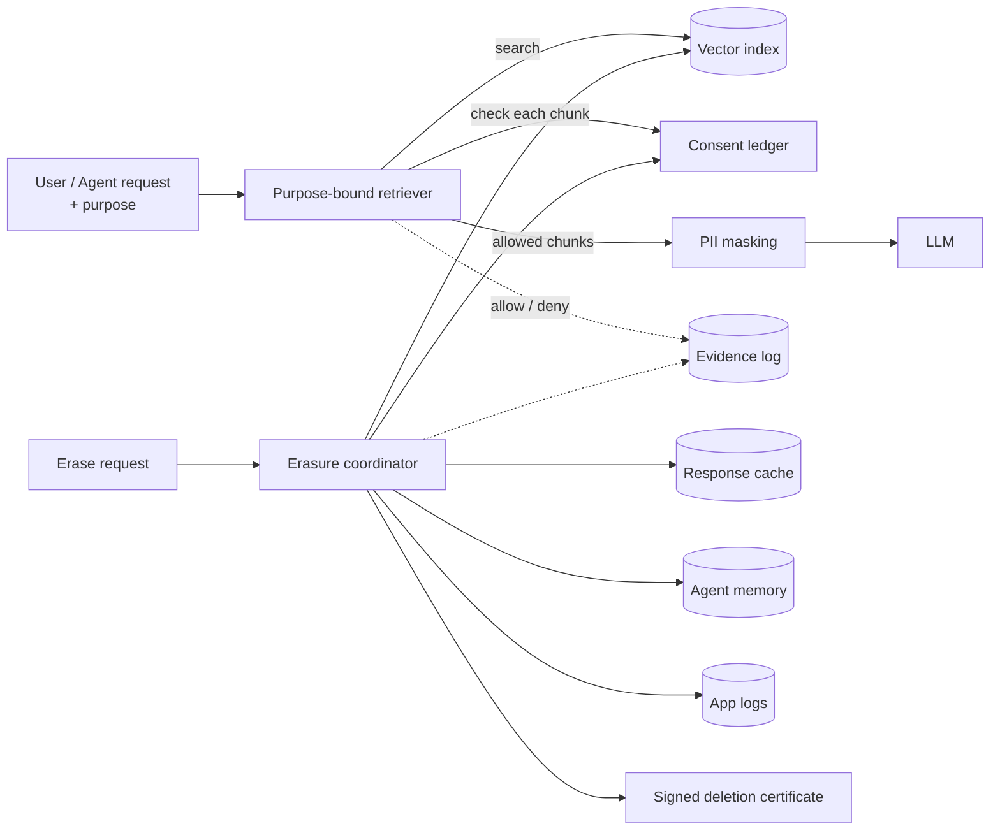

# Vismriti

**Consent, purpose limitation and right-to-erasure for RAG and AI agents, built for India's DPDP Act.**

*Vismriti (विस्मृति) is Sanskrit for "forgetting". Under the DPDP Act, your AI has to learn how.*

[](https://github.com/Malaya-kumar-swain/vismriti/actions)
  

---

## The problem

Indian companies are putting customer data into GenAI systems: support copilots, KYC assistants, sales agents. The Digital Personal Data Protection Act 2023 and the DPDP Rules 2025 now ask three questions those systems were never designed to answer:

1. **Was this person's data allowed to be used for *this* purpose?** RAG retrieves whatever is semantically closest, not what the customer consented to.
2. **When a customer withdraws consent or asks for erasure, is their data gone *everywhere*?** In an AI stack it sits in the vector index, the response cache, the agent's memory and the prompt logs.
3. **Can you prove it?** To the customer, your DPO and the Data Protection Board.

Masking Aadhaar and PAN numbers is necessary but not sufficient, and several good libraries already do it. Vismriti handles the part after masking: **consent-aware retrieval, erasure that propagates, and evidence you can hand to an auditor.**

## What it does

| | |
|---|---|
| 🧾 **Consent ledger** | Who agreed to which purpose, under which notice version, and when they withdrew. Hash-chained and tamper-evident. Retention periods lapse consent automatically. |
| 🎯 **Purpose-bound retrieval** | A chunk reaches the model only if it was collected for the request's purpose **and every person in it** has active consent. Joint accounts and group chats included. |
| 🧹 **Erasure that propagates** | One call withdraws consent, erases the person from the vector index, response cache, agent memory and logs, re-checks that nothing remains, and returns a **signed deletion certificate**. |
| 🔍 **Right to access** | `access_summary()` lists purposes, consent history and items held per store, without exposing raw data. |
| 📋 **Evidence pack** | Every allow, deny, withdrawal and erasure goes into a hash-chained log with a Markdown report mapped to DPDP sections. The log never stores raw personal data. |
| 🇮🇳 **Indian PII masking** | Aadhaar (Verhoeff-checksum validated), PAN, GSTIN, IFSC, UPI, Indian mobile and email, including digits written in Devanagari, Odia, Bengali, Tamil, Telugu, Kannada, Gujarati and Gurmukhi. Bring your own detector through a one-method interface. |
| 🤖 **MCP server** | Agents can call `check_purpose`, `record_consent`, `retrieve`, `access_summary` and `erase_principal` before they touch personal data. |

Zero runtime dependencies in the core. The MCP server is an optional extra.

## How it fits



## Quick start

```bash
git clone https://github.com/Malaya-kumar-swain/vismriti && cd vismriti
pip install -e ".[dev]"
python examples/bank_assistant_demo.py
pytest -q
```

```python
from vismriti import Purpose, Vismriti

v = Vismriti(
    purposes=[Purpose("kyc", "Verify identity", retention_days=3650),
              Purpose("support", "Answer service requests", retention_days=365)],
    signing_key=b"load-this-from-your-secret-manager",
)

v.grant("cust-asha", "support", notice_version="2026-10")
v.ingest("ticket-1", "Asha asked to raise her UPI limit, UPI id asha.rao@okhdfcbank.",
         principals=["cust-asha"], purposes=["support"])

v.retrieve("UPI limit", purpose="support")    # → ticket-1, with the UPI id masked
v.retrieve("UPI limit", purpose="marketing")  # → ValueError: unknown purpose (not declared)

cert = v.erase("cust-asha")                   # vector index, cache, memory, logs, consents
assert cert.complete and v.verify_certificate(cert)
print(v.report("cust-asha"))                  # evidence pack for the DPO
```

### Demo output (abridged)

```
── 1. Support agent asks about UPI limits (purpose = support)
  ✔ ticket-asha: Asha Rao asked to raise her UPI limit; UPI id [UPI]. Prefers Hindi.
  ✘ ticket-ravi was withheld: Ravi never consented to 'support'.
── 2. Marketing team tries the same data (purpose = marketing)
  results: []  ← nothing leaks
── 4. Asha withdraws consent and asks for erasure (DPDP s.6(4), s.12)
  vector_index    found 2  erased 2  remaining 0
  response_cache  found 1  erased 1  remaining 0
  agent_memory    found 1  erased 1  remaining 0
  app_logs        found 1  erased 1  remaining 0
  complete=True  signature valid=True
```

## Use with AI agents (MCP)

```bash
pip install -e ".[mcp]"
VISMRITI_KEY=<32+ random characters> VISMRITI_PURPOSES=kyc,support python -m vismriti.mcp_server
```

Add it to any MCP client (Claude Desktop, IDE agents, your own) as a stdio server. The agent then gets tools to check purpose, record or withdraw consent, run purpose-bound retrieval, mask text, produce an access summary and erase a person.

## Plug in your own stack

Anything that holds personal data can join erasure by implementing two methods:

```python
class MyPgVectorStore:
    name = "pgvector"
    def find(self, principal_id: str) -> list[str]: ...
    def erase(self, principal_id: str) -> int: ...

v = Vismriti(purposes, key, extra_stores=[MyPgVectorStore(), MyRedisCache(), MyBackupIndex()])
```

Detectors work the same way: anything with `detect(text) -> list[Finding]` (Presidio, bharat-pii, an NER model) can replace the built-in one.

## DPDP mapping

See [docs/dpdp-mapping.md](docs/dpdp-mapping.md) for a section-by-section table of what is covered, what is partial and what is not yet. Limits are listed honestly in [docs/threat-model.md](docs/threat-model.md); for example, erasure covers stores, not data already baked into fine-tuned model weights.

## Roadmap

- [ ] Adapters: Chroma, pgvector, Qdrant, Redis, OpenSearch
- [ ] Consent-manager integration (DPDP Rules, consent artefacts)
- [ ] Ed25519 certificates and key rotation
- [ ] Breach-intimation workflow (s.8(6)) and grievance tracking (s.13)
- [ ] Right to correction (s.12) with re-embedding
- [ ] LangChain / LlamaIndex retriever wrappers
- [ ] Name and address detection for Indian languages via pluggable NER

## Disclaimer

Vismriti is an engineering aid, not legal advice. It helps you implement and evidence controls; whether a system complies with the DPDP Act depends on far more than code. All names and numbers in this repository are synthetic.

## Author

Built by **Malaya Kumar Swain**, AI technology leader working on agentic and voice AI, responsible AI and data platforms. · [Portfolio](https://malayakumarswain.com) · [LinkedIn](https://www.linkedin.com/in/malayakumarswain)

Licensed under [Apache 2.0](LICENSE).
